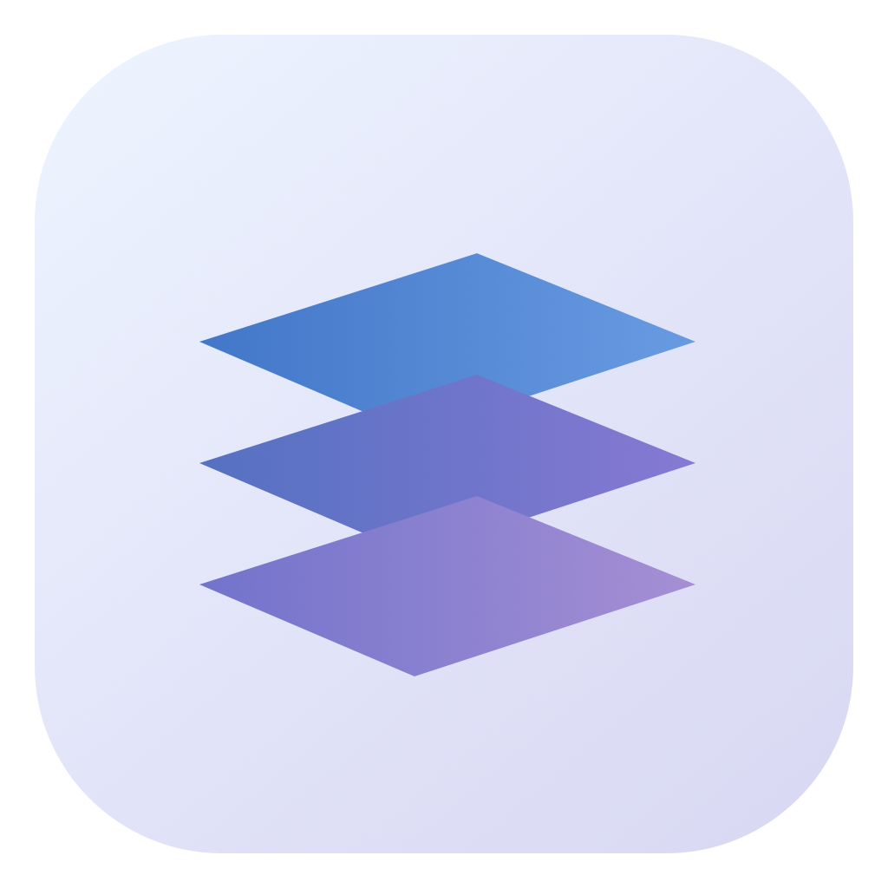
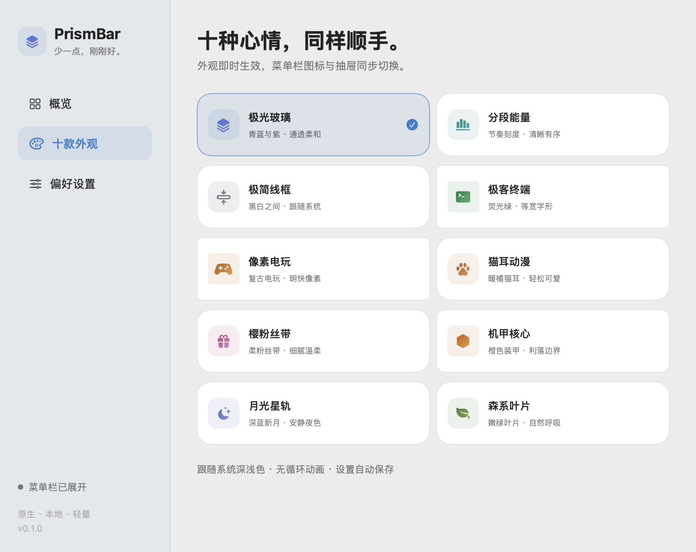
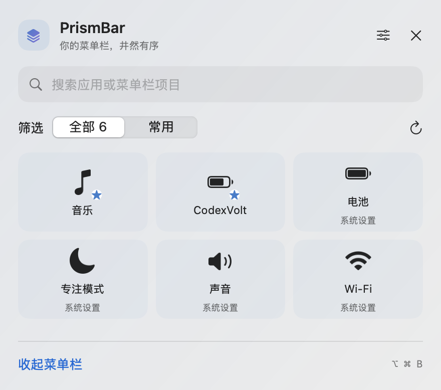

<p align="center"></p>
<h1 align="center">PrismBar · 棱镜菜单栏</h1>
<p align="center">少一点，刚刚好。<br>原生 macOS 菜单栏整理工具 · 十款外观 · 无需屏幕录制</p>

**本地候选版 0.1.0。** 已完成 Intel Mac 上的行为测试、原生界面和部分辅助功能实测；最终原菜单点击及外部图标折叠仍待确认，尚未发布。详见 [验证记录](docs/VALIDATION.md)。



## 简单收纳，随手展开

- **直接折叠**：按分隔线收起菜单栏图标；再次点击恢复，无需辅助功能权限。
- **聚合抽屉**：通过辅助功能发现系统允许访问的菜单栏项目，搜索应用名称，右键加入常用，点击尝试打开原应用菜单。面板显示全部可访问项目，不仅是已隐藏图标。
- **更克制的权限**：使用应用图标与文字，不请求屏幕录制，不获取窗口内容，不截取图标图片。图标上的实时数值、徽标不会被镜像显示。
- **少打断**：仅点击触发；支持 ⌥⌘B。自动收回在辅助功能可用时启用，避开指针停留菜单栏、打开中的菜单和设置窗口。
- **十种心情**：极光玻璃、分段能量、极简线框、极客终端、像素电玩、猫耳动漫、樱粉丝带、机甲核心、月光星轨、森系叶片。
- **原生轻量**：Swift / AppKit / SwiftUI；无第三方依赖、网络请求或遥测。空闲时不扫描，打开抽屉或手动刷新时才读取项目；不使用循环动画。

## 安装与首次设置

本地安装包位于 `dist/`，完成验收后再发布到 GitHub Releases。要求 macOS 13+。Intel 使用 `PrismBar-macOS-x86_64.zip`，Apple Silicon 使用 `PrismBar-macOS-arm64.zip`。后者已交叉编译，尚无 ARM 真机验证。

1. 解压，将 `PrismBar.app` 放进“应用程序”后打开。
2. 按住 **Command**，把低频图标拖到分隔线左侧。常用图标和 PrismBar 入口放在右侧。
3. 在概览中点击“已放好，开始使用”。Option 点按入口可随时展开或收起；右键入口打开设置。
4. 要使用抽屉搜索及项目点击，在“系统设置 → 隐私与安全性 → 辅助功能”允许 PrismBar，再点击“重新检测”。不授予时仍可使用折叠模式。
5. 登录时启动默认关闭，可在偏好设置开启。

当前安装包采用本地 ad-hoc 签名，未获 Apple Developer ID 签名和公证。其他电脑可能出现来源提示；可核验源代码与 SHA-256 并在本机构建，无需关闭系统保护。替换 ad-hoc 构建后，macOS 可能仍显示授权开启，但旧授权不能匹配新构建。如果应用“重新检测”仍未就绪，请在辅助功能列表移除旧 PrismBar，再通过“＋”添加当前 `/Applications/PrismBar.app`；系统可能要求你本人解锁。



图片由真实原生视图渲染；抽屉中的项目是明确设置的演示数据，不是用户账户或实际机器的读取结果。

## 使用边界

- macOS 没有完整公开的菜单栏管理接口。折叠使用公开 `NSStatusItem` 的宽度机制，需要用户确定分隔线位置；不主动替用户拖动其他应用图标。
- 某些系统图标、输入法、应用菜单不提供可访问的辅助功能节点或点击动作。明确失败时保持原菜单栏展开并显示原因；响应超时不会再次点击或抢走菜单焦点，无法确认结果时暂停自动收回。不会用打开 App 冒充打开图标菜单。
- 抽屉不镜像动态徽标，不提供永久隐藏分组、全局图标间距更改或自动移动图标。
- 没有辅助功能权限时无法可靠判断别的 App 菜单状态，因而暂停自动收回。
- 切换显示器时主动展开，避免原布局变化后图标难以找回。多屏和刘海真机仍需进一步验证。
- 应用若没有稳定的辅助功能标识，收藏按同一应用的项目顺序识别；项目数量或顺序变化后可能需要重新收藏。
- 不建议同时启用多个菜单栏折叠工具，它们会共同影响系统布局。

## 从源码构建

安装 Xcode Command Line Tools，然后执行：

```bash
bash scripts/test.sh
bash scripts/build.sh
# 可选：交叉编译 Apple Silicon
PRISMBAR_ARCH=arm64 bash scripts/build.sh
```

ZIP 在 `dist/`。构建缓存默认放在 `~/Library/Caches/PrismBar/build`，`.app` 在临时目录签名打包，避免云同步属性破坏签名。可用 `PRISMBAR_BUILD_DIR`、`PRISMBAR_DIST_DIR` 覆盖路径。

验证命令（先安装 App）：

```bash
/Applications/PrismBar.app/Contents/MacOS/PrismBar --diagnostics
/Applications/PrismBar.app/Contents/MacOS/PrismBar --smoke-test
/Applications/PrismBar.app/Contents/MacOS/PrismBar --render-previews /tmp/PrismBar-previews
```

`--smoke-test` 创建独立测试偏好与临时状态项，验证创建、折叠、主题资源、抽屉重复激活与退出；它不会证明其他应用的图标点击兼容性。预览导出使用演示项目，并短暂创建原生窗口，不读取屏幕像素。

## 隐私与卸载

只保存主题、模式、延迟、收藏及首次设置状态到 `io.github.xx1999DK.PrismBar` 偏好域。不记录菜单内容到磁盘，不读 Codex 账号，不联网。登录项由 macOS `SMAppService` 管理。

卸载前关闭“登录时启动”，右键入口退出，再移除应用。退出会撤销折叠分隔项，系统重新展示图标。辅助功能授权可在系统设置撤销。

## 设计与来源

[研究与设计取舍](docs/RESEARCH.md) · [验证记录](docs/VALIDATION.md) · [MIT License](LICENSE)

PrismBar 是独立项目。交互参考 iBar 的收纳初衷，十种风格参考 [CodexVolt](https://github.com/xx1999DK/CodexVolt)。不包含 iBar 代码、商标、付费资源，也不代表 Better365 或 Apple；应用界面使用系统提供的 SF Symbols。源代码采用 MIT 许可，系统字体及符号遵循各自许可。
